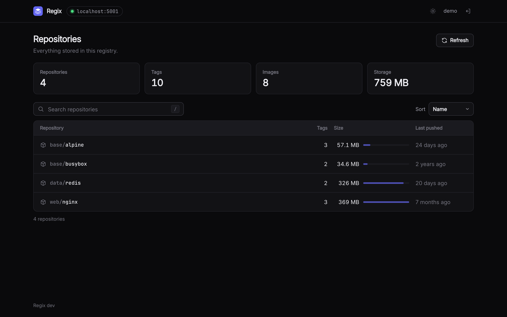
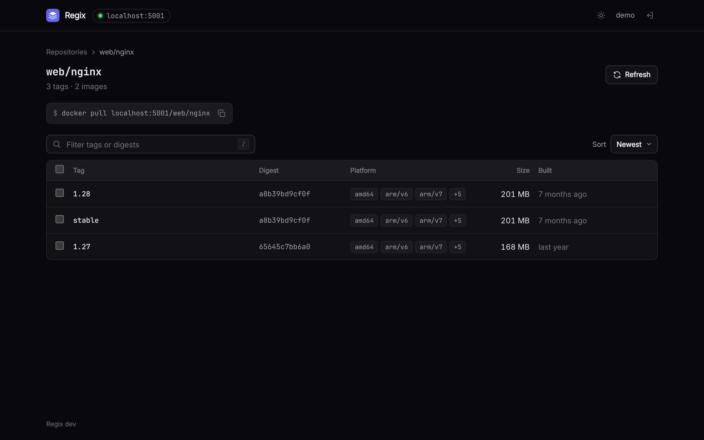
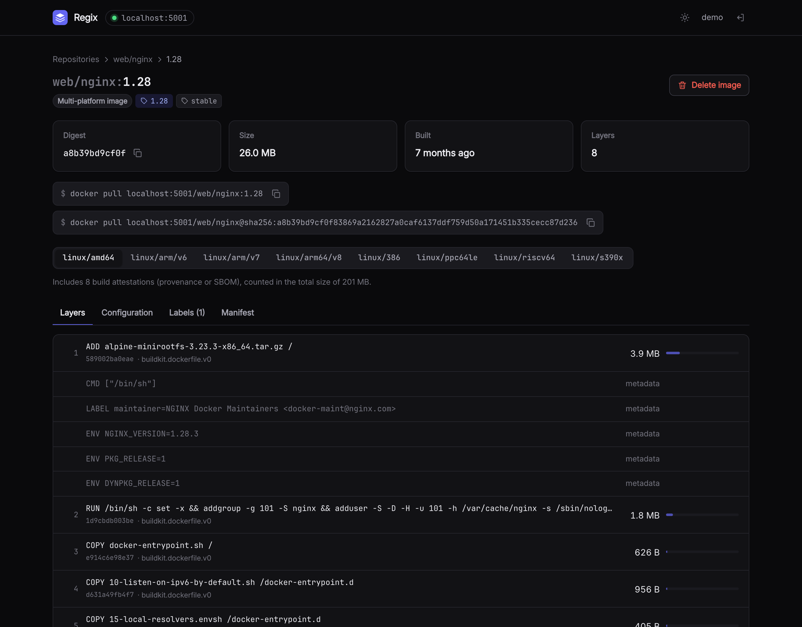
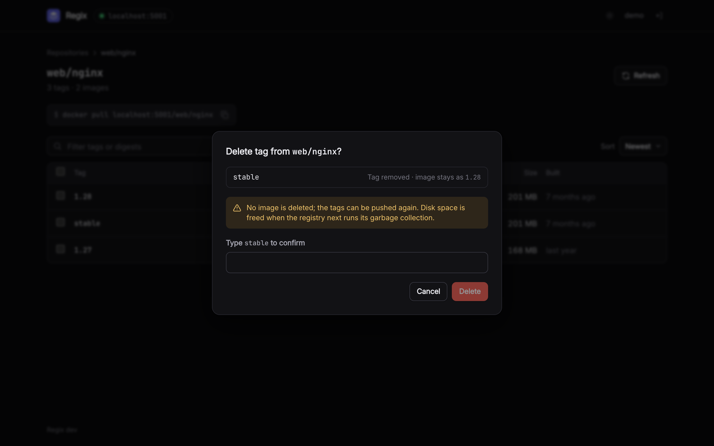
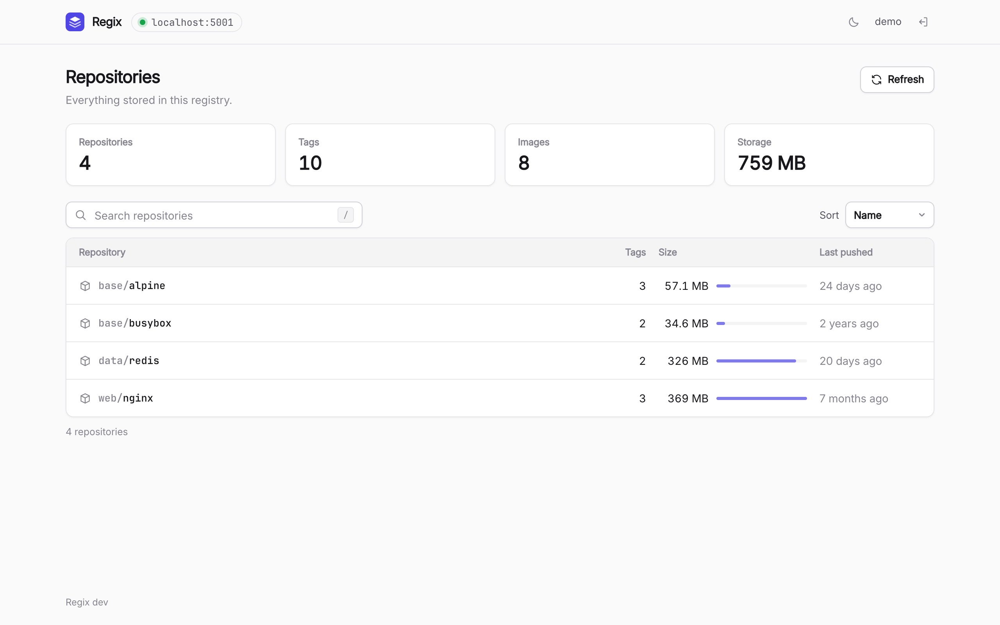
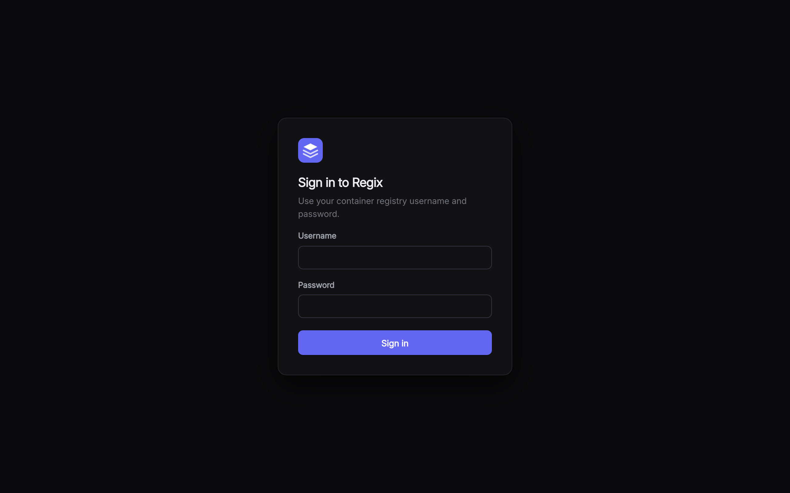
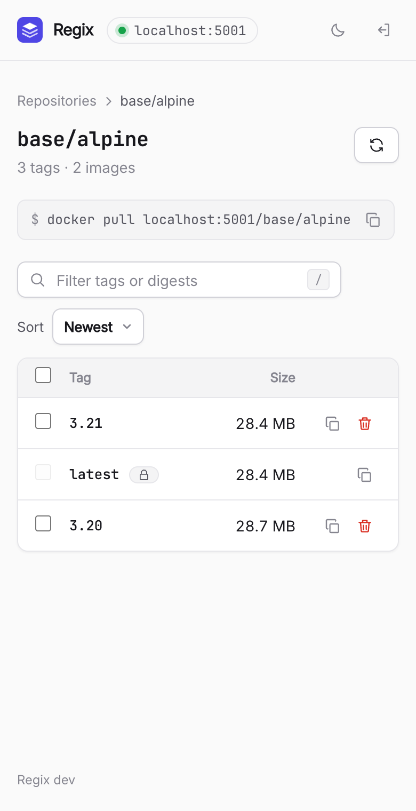

# Regix

A small, fast web interface for a self-hosted Docker / OCI registry
([CNCF Distribution](https://distribution.github.io/distribution/), the `registry:2` and
`registry:3` images).

Browse repositories and tags, see what an image is made of, find out what takes up space, and
delete what you no longer need, without `curl` and without changing anything in the registry.



- **One container, nothing else.** A 16 MB image with a single static binary. No database, no
  cache server, no sidecar. It uses 5 to 15 MB of memory.
- **Works with the registry you have.** Regix talks to the standard registry API. Point it at the
  registry's address; the registry's own configuration stays as it is.
- **Your registry's users are Regix's users.** By default people sign in with their registry
  username and password. Credentials stay on the server and never reach the browser.
- **Careful with deletion.** Every deletion says exactly what will happen before it happens, has to
  be confirmed by typing the name, and can be restricted with protected tags or switched off.

## What you get

| | |
|---|---|
| **Overview** | Every repository with its tag count, size and last push; totals for the whole registry. |
| **Storage** | Compressed size per repository and in total, with layers shared between images counted once. |
| **Tags** | Digest, platforms, size and build time of each tag. Filter, sort, select many. |
| **Images** | Layers with the build step that produced each one, entrypoint, environment, ports, labels, and the raw manifest. Multi-platform images show each platform. |
| **Deleting** | Remove one tag or many. An image is deleted when its last tag goes; otherwise only the tag is removed. |
| **Comfort** | Light and dark themes, works on a phone, `/` to search, one-click copy of pull commands and digests. |

## Screenshots

| | |
|---|---|
| **Tags of a repository**, with digest, platforms, size and build time<br><br> | **An image**, layer by layer, for each platform<br><br> |
| **Deleting** says what will happen and asks for the name<br><br> | **Light theme**<br><br> |
| **Sign-in** with registry credentials<br><br> | **On a phone**<br><br> |

## Try it

This starts a registry, fills it with a few public images and puts Regix in front of it:

```bash
git clone <this repository> regix && cd regix
make demo        # or: docker compose -f examples/demo/docker-compose.yml up --build
```

Open <http://localhost:8080> and sign in as `demo` / `demo-password`.

## Install

The image is on Docker Hub as [`amanj/regix`](https://hub.docker.com/r/amanj/regix), for
`linux/amd64` and `linux/arm64`. Use a version tag such as `amanj/regix:0.1.0` in production;
`latest` is the newest release.

### Docker

```bash
docker run -d --name regix -p 8080:8080 \
  -e REGIX_REGISTRY_URL=https://registry.example.com \
  amanj/regix:latest
```

### Docker Compose

```bash
REGIX_REGISTRY_URL=https://registry.example.com docker compose up -d
```

See [docker-compose.yml](docker-compose.yml).

### Kubernetes with Helm: registry, storage and UI together

The [Helm chart](deploy/helm/regix) installs a complete setup: the registry with its volume,
authentication and scheduled garbage collection, and Regix in front of it.

```bash
helm install registry deploy/helm/regix --namespace registry --create-namespace \
  --set registry.auth.users[0].username=ci --set registry.auth.users[0].password="$CI_PASSWORD"
```

It can also install only the UI (`registry.enabled=false`).

### Kubernetes with plain manifests: UI only

Set your registry's address in
[deploy/kubernetes/deployment.yaml](deploy/kubernetes/deployment.yaml) and your host name in
[deploy/kubernetes/ingress.yaml](deploy/kubernetes/ingress.yaml), then:

```bash
kubectl apply -k deploy/kubernetes
```

When the registry runs in the same cluster, use its Service address
(`http://<service>.<namespace>.svc:<port>`) as `REGIX_REGISTRY_URL` and its public host name as
`REGIX_REGISTRY_PULL_HOST`.

## Configure

One setting is required: the registry's address.

| Variable | Default | Meaning |
|---|---|---|
| `REGIX_REGISTRY_URL` | (required) | Where Regix reaches the registry. |
| `REGIX_REGISTRY_PULL_HOST` | host of the URL | The host shown in `docker pull` commands. |
| `REGIX_AUTH_MODE` | `registry` | Who may sign in: `registry`, `static` or `none` (below). |
| `REGIX_READ_ONLY` | `false` | Switch off deleting. |
| `REGIX_PROTECTED_TAGS` | (none) | Tags that cannot be deleted, e.g. `latest,v*`. |

All settings, the configuration file format and examples are in
[docs/configuration.md](docs/configuration.md).

### Signing in

| Mode | Users sign in with | Regix reaches the registry as | Use it when |
|---|---|---|---|
| `registry` (default) | their registry username and password | that user | the registry has its own users (htpasswd or token auth) |
| `static` | an account in an htpasswd file given to Regix | a service account you configure | UI users should differ from registry users |
| `none` | nothing | a service account, or anonymously | another layer already authenticates (SSO proxy, VPN), ideally with `REGIX_READ_ONLY=true` |

## What the registry needs

- **For browsing:** nothing. Any registry that speaks the Distribution API works.
- **For deleting:** deletion has to be allowed in the registry's configuration
  (`storage.delete.enabled: true`, or `REGISTRY_STORAGE_DELETE_ENABLED=true`). Removing a single
  tag from an image that has several needs Distribution 3.0 or newer.
- **For getting disk space back:** deleting through the API removes the *reference* to an image.
  The registry frees the storage when its garbage collector runs
  (`registry garbage-collect --delete-untagged /etc/distribution/config.yml`), which you schedule
  yourself. Regix says so in every delete dialog.

## How deletion works

You always delete **tags**. Regix works out what that means for the images behind them and shows
it before you confirm:

- A tag whose image has **other tags** is removed; the image stays.
- A tag that is the **last one** on its image deletes the image.
- A tag that matches `REGIX_PROTECTED_TAGS` cannot be selected.
- A tag that was pushed again after you loaded the page is left alone, so you never delete an
  image you have not seen.

Each deletion is written to the log with the user, repository, tag and digest.

## Good to know

- **Sizes are calculated, not measured.** The registry API does not report disk usage, so Regix
  adds up the compressed sizes of the blobs that tagged images reference. Untagged images and
  unfinished uploads still occupy disk space until garbage collection, and are not included.
- **The first load of a large registry takes a while.** Regix reads each image once, at most
  eight requests at a time, then remembers it (image contents never change). Listings are reused
  for `REGIX_CACHE_TTL` (30 seconds).
- **Run one replica.** Sessions live in memory. Restarting Regix signs everyone out, nothing more.
- **Serve it over HTTPS** whenever it is reachable beyond localhost; it handles registry passwords.
  More in [SECURITY.md](SECURITY.md).

## Development

Regix is a Go server with an embedded [Preact](https://preactjs.com) interface. The design is
described in [docs/architecture.md](docs/architecture.md).

```bash
make demo                      # a registry to work against, on localhost:5001
cd ui && npm install && npm run dev    # the interface with hot reload, on localhost:5173
make check                     # formatting, vet, tests, type check
```

See [CONTRIBUTING.md](CONTRIBUTING.md).

## License

[MIT](LICENSE)
